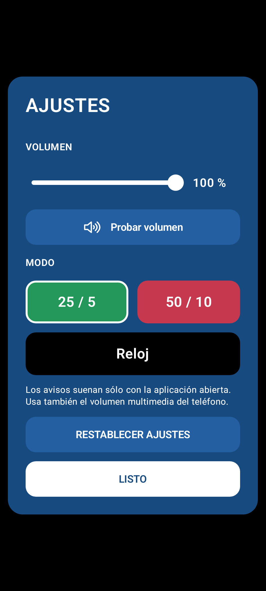
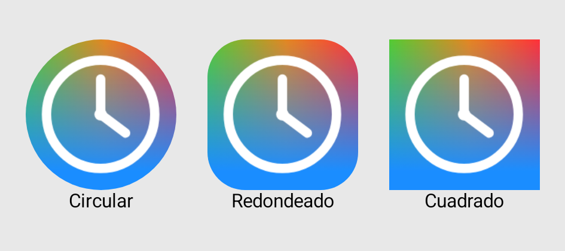

[](https://github.com/jstihl01/AutoPomodoro_Mobile/releases/latest/download/AutoPomodoro.apk)

# AutoPomodoro para Android

Un Pomodoro sincronizado con la hora real y un reloj digital que mantiene la pantalla encendida mientras lo estás viendo. Sin iniciar, pausar ni reajustar temporizadores. Funciona sin conexión, cuentas, publicidad ni telemetría.

## Instalar en el móvil

1. Pulsa **Descargar APK**, al principio de esta página, desde tu teléfono Android.
2. Abre `AutoPomodoro.apk` y permite la instalación desde el navegador o el gestor de archivos si Android lo solicita.
3. Abre **AutoPomodoro**. El primer inicio usa 25/5; en **Ajustes** puedes seleccionar Reloj o 50/10.

Requiere **Android 7.0 o posterior**. Las actualizaciones se instalan sobre la versión anterior y conservan los ajustes. El APK es universal: incluye ARM y x86, de 32 y 64 bits.

El archivo [AutoPomodoro.apk.sha256](https://github.com/jstihl01/AutoPomodoro_Mobile/releases/latest/download/AutoPomodoro.apk.sha256) permite verificar la descarga. [Todas las versiones y sus notas](https://github.com/jstihl01/AutoPomodoro_Mobile/releases).

## Tres modos

| Modo | Comportamiento | Aspecto |
|---|---|---|
| **25/5** | Trabajo de `:00` a `:25` y de `:30` a `:55`; descanso los cinco minutos restantes de cada media hora. | Verde durante el trabajo; azul en descanso. |
| **50/10** | Trabajo de `:00` a `:50`; descanso los últimos diez minutos de cada hora. | Rojo durante el trabajo; azul en descanso. |
| **Reloj** | Hora local `HH:mm:ss`, en formato de 24 horas. Sin fases ni sonidos. | Cifras blancas grandes monoespaciadas sobre negro plano. |

Los ciclos se calculan a partir de la hora del teléfono: abrir a las 14:17 en 25/5 muestra ocho minutos de trabajo restantes. Al volver de otra aplicación, cambiar de zona horaria o ajustar el reloj del sistema, se sincroniza automáticamente.

La vista principal ocupa la pantalla y se adapta a vertical y horizontal. El menú de la esquina superior derecha permite cambiar de modo, ajustar el volumen entre 0 y 100 %, usar «Probar volumen» y restablecer los ajustes. El volumen inicial y el valor al restablecer son 100 %. Se respetan los niveles que el usuario ya haya guardado. Se recuerdan modo y volumen.

La interfaz sigue el diseño de Windows 2.0: colores planos, botones redondeados, selectores con borde blanco y cifras monoespaciadas de ancho estable. Sólo el icono de marca conserva el degradado; su fondo cubre toda la superficie del launcher.

Previsualizaciones locales de Android Studio:

<p>
  
  
  
  
</p>




La señal de los pitidos tiene una amplitud 2,57 veces mayor (+8,2 dB) que en 1.0.0, con margen para evitar recorte. Se reproduce por el canal multimedia, que puedes ajustar con los botones del teléfono. La amplitud no equivale a una medida exacta del volumen percibido en cada altavoz. Consulta el [informe de validación de 1.1.0](docs/VALIDATION-2026-11-05.md).

Al comenzar el descanso suena un tono; al volver al trabajo suenan tres tonos. El nivel depende también del volumen y de la configuración de sonido del dispositivo. No se modifica el volumen general del móvil.

## Pantalla encendida

Mientras AutoPomodoro está visible, evita el apagado por inactividad en cualquiera de sus modos. Respeta el brillo del sistema. Para usarlo como reloj, selecciona **Reloj** y coloca el móvil en la orientación que prefieras.

Al pulsar Inicio, cambiar de aplicación o bloquear el móvil, deja de actualizarse y de emitir sonidos. Al regresar recupera la hora y fase actuales, sin reproducir avisos atrasados. No utiliza servicios, alarmas ni notificaciones en segundo plano y respeta el bloqueo manual.

## Abrir y probar en Android Studio

Abre la carpeta raíz del proyecto, sincroniza Gradle, selecciona la variante **debug** y ejecuta **Run** en tu teléfono o emulador. La instalación de desarrollo tiene sufijo `.debug` y puede coexistir con el APK descargado.

El proyecto conserva la base Kotlin y Jetpack Compose de Android Studio: SDK de compilación y destino 37, mínimo 24, Gradle 9.5 y JDK 25. Configura **Gradle JDK** con el JDK de Android Studio. `local.properties` contiene la ubicación local del SDK y no se publica.

```powershell
./gradlew.bat testDebugUnitTest lintDebug assembleDebug
./gradlew.bat connectedDebugAndroidTest
```

La primera orden ejecuta pruebas unitarias, análisis y compilación. La segunda necesita un dispositivo conectado. Consulta [las pruebas y su validación](docs/TESTING.md).

## Generar una versión de producción

```powershell
./scripts/build-release.ps1
```

Genera `releases/AutoPomodoro.apk` firmado y su checksum. Necesita la clave permanente privada: consulta [firma y copias de seguridad](docs/SIGNING.md). Nunca publiques los archivos de `.private/`.

La integración continua comprueba cada push. Las capturas y los informes de las pruebas en emulador se conservan como artefactos de GitHub Actions.

La aplicación de Windows se utilizó únicamente como referencia para el comportamiento, los colores, los tonos y el icono.
